# How neon1 is built

neon1 runs on a few AWS services, sized to cost a few dollars a month while it's quiet. Everything is defined in code in public [GitHub](https://github.com/neon1llc) repositories.

## The whole picture

One CloudFront distribution serves neon1.tech and routes each address to the website, the 1NEON portal and its API, or Neo's API. Buckets are private, and every visit uses HTTPS with strict security headers.

- **Website.** Plain HTML, CSS, and JavaScript, with no framework and no tracking. Its security policy blocks every outside file.
- **1NEON.** A single-page app with its own API. Sign-in is an emailed code or a passkey through Cognito, with no passwords. Files go from the browser to a private bucket and are scanned for malware. Invoices are paid on Stripe's checkout page, so card and bank details never reach neon1.
- **Neo.** A function that answers from neon1's public documents with a model on Amazon Bedrock. Per-visitor limits keep it fair and cheap.
- **Watching it.** Alarms and monthly budgets email Pradeep when something fails or costs more than expected.

### Inside 1NEON

Signed approvals, handover acceptances, agreement signatures, issued invoices, and payments are also copied to a records bucket under S3 Object Lock in governance mode, which write-protects each copy for seven years. Stripe's restricted key and webhook secret are SecureString parameters under `/1neon/prod/stripe/`. Terraform creates them with placeholders and never sees the real values. Until they're set, online payment stays off.

## Paying an invoice

Card and bank details go only to Stripe. 1NEON learns of a payment only from Stripe's signed webhook and records each payment once.

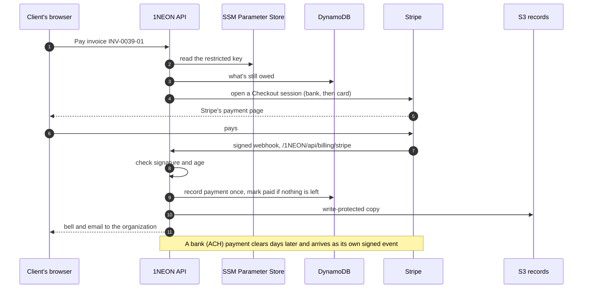

## Visiting neon1.tech

Each deploy uploads a whole new site folder, and one release store tells CloudFront which folder is live. Every file in a visit comes from the same release.

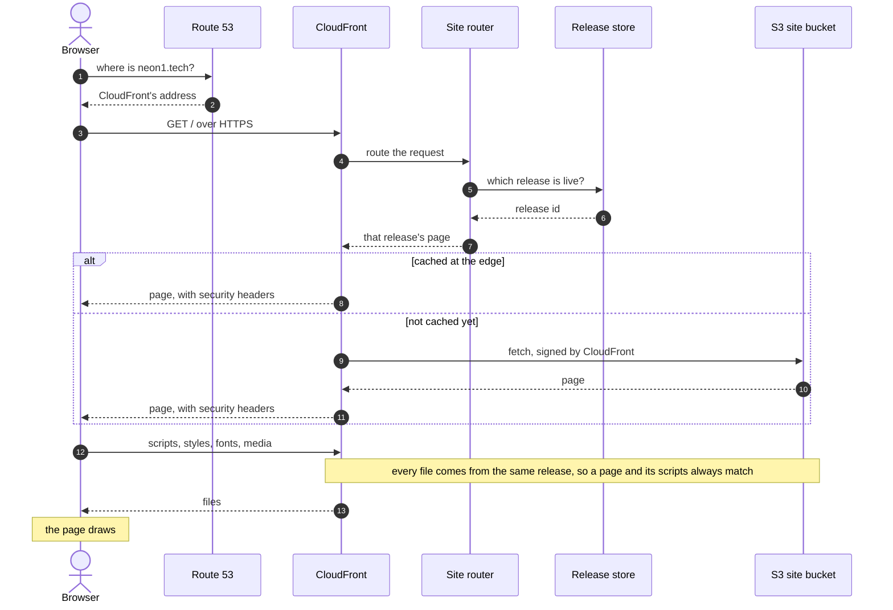

## Asking Neo

Each question goes through CloudFront, which adds a secret header so the API answers only through neon1.tech, and through a limits check before the model sees it.

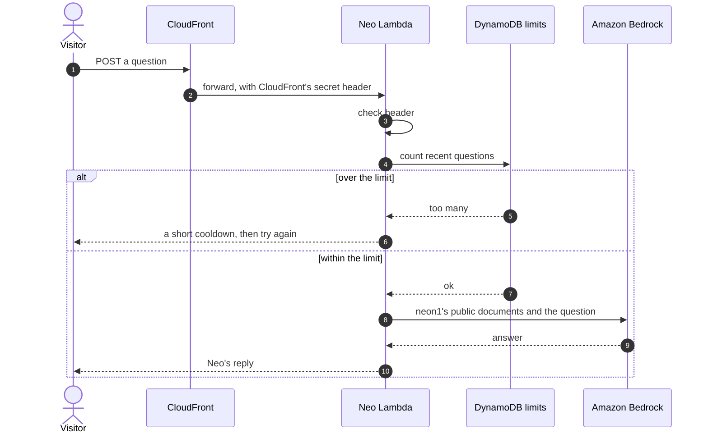

## Signing in to 1NEON

The email-code sign-in. A passkey replaces the code with the device's own check, and an authenticator app adds a 6-digit second step.

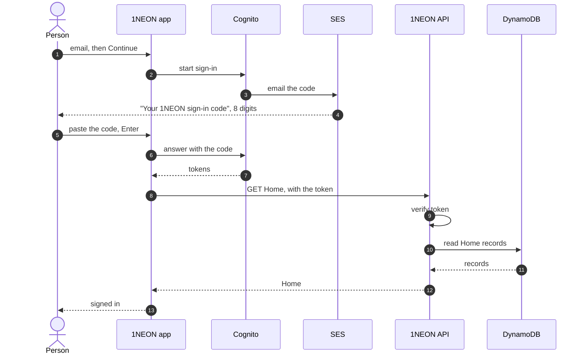

## Production and dev, part by part

Production serves clients and visitors. Dev is a private copy for trying changes, with its own buckets, distribution, release store, backend, sign-in pool, and permissions, so it can't reach production or client data.

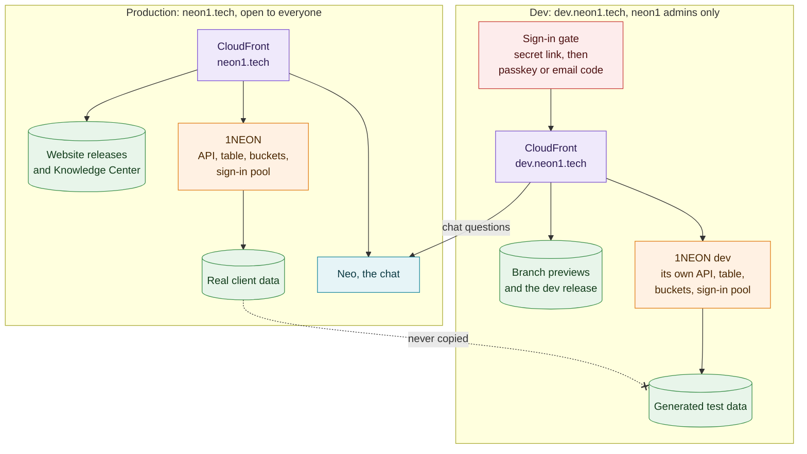

| Part | Production | Dev |
|---|---|---|
| **Website** | neon1.tech, from whole releases in the site bucket. | dev.neon1.tech, with its own bucket, distribution, and release store. Every branch push builds a preview. |
| **Knowledge Center and blog** | Built with every site deploy, and republished within about 15 minutes of a new corpus release. | Built from the newest corpus release or a corpus branch. PDFs are copied, not printed. |
| **1NEON** | neon1.tech/1NEON, with its own API, table, buckets, and sign-in pool. Malware scanning and seven-year record protection are on. | dev.neon1.tech/1NEON, with generated test data only. Only neon1's accounts can sign in, mail goes only to neon1, and texts and malware scan are off. |
| **Neo** | neon1.tech/chat/api, from the corpus copy it was last released with. | No dev copy. Dev uses the live Neo. |

## What data each part keeps

One AWS account in us-east-1, encrypted in transit and at rest. Production holds real client data.

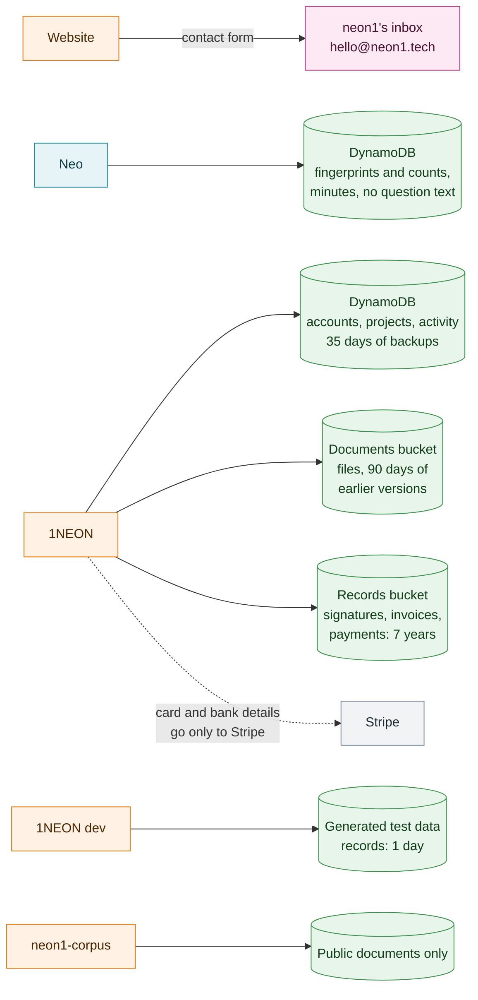

| Part | What it keeps | How long |
|---|---|---|
| **Website** | No accounts, cookies, analytics, or trackers. Contact form messages are emailed to hello@neon1.tech, not stored. Form limits count senders by a one-way code of their address. | CloudFront handles IP addresses and browser details to deliver pages, and AWS may keep them briefly. Form counters expire a day after the first count. |
| **Neo** | No question or answer text. A one-way fingerprint of each question to spot repeats, and visitor counts by one-way code. Logs hold timing, length, and errors. Bedrock logging is off. | Fingerprints ten minutes. Logs two weeks. |
| **1NEON projects** | Accounts, projects, decisions, comments, and activity in DynamoDB, and files in the documents bucket, each organization kept separate. | Deleted when an organization asks. Database backups roll off after 35 days, earlier file copies after 90. |
| **1NEON records** | A copy of every signature, issued invoice, and payment under S3 Object Lock, because tax and contract law expect them kept. | Write-protected for seven years. |
| **1NEON system records** | The audit log of sign-ins and changes, and email and text delivery records. | Audit log up to three years, delivery records 30 days, API logs 90 days. |

The [privacy and data policy](../policies/privacy.md) is the full statement and wins if anything here differs.

## How a change ships

A change starts on its own branch, where checks run on every push. Website and 1NEON changes can be seen on dev. I review each batch, and it goes to production once it passes. It merges to main and the pipeline runs every check again, deploys, confirms the live version, and tags the release. GitHub Actions signs in to AWS with short-lived OpenID Connect credentials, and each role trusts only its own repository, so no repository holds AWS keys.

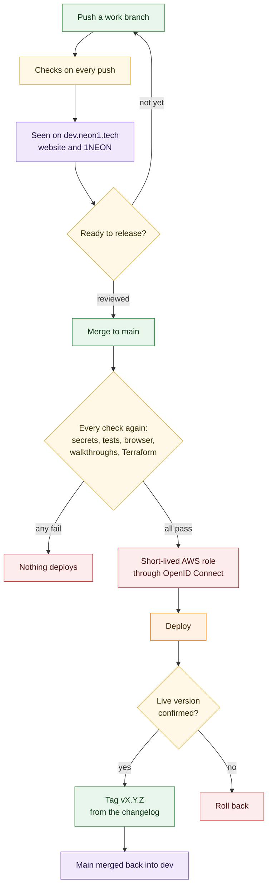

| Repository | Checks on every push | What main does | About how long |
|---|---|---|---|
| **neon1-site** | HTML, scripts, links, assets, sizes, secret scan, built corpus pages, and browser checks with every API faked | Prints PDFs, uploads a new release, switches the release store, confirms the live version, and tags | With the corpus and Neo, about 12 to 18 minutes |
| **neon1-1NEON** | Types, tests, build, secret scan, Terraform checks, and every guided walkthrough played to its end in a real browser | Applies Terraform, ships the API, then the app with its page last, confirms, and tags | About 26 minutes, mostly the walkthroughs |
| **neon1-chat** (Neo) | Tests with AWS faked, Terraform checks, and a secret scan | Applies Terraform, which ships the function, checks the live endpoint, and tags | Within the 12 to 18 minutes above |
| **neon1-corpus** | Front matter, links, anything that looks private, the renderer, and every diagram with alt text | Tags the release, publishes a bundle for each reader, and asks neon1.tech to publish it | Within the 12 to 18 minutes above |

- **Tags follow the changelog.** Each change adds an entry under `## Unreleased`. On deploy it becomes the new version, and the pipeline tags it once the live version is confirmed. Dev builds are never tagged.

### Deploying the website

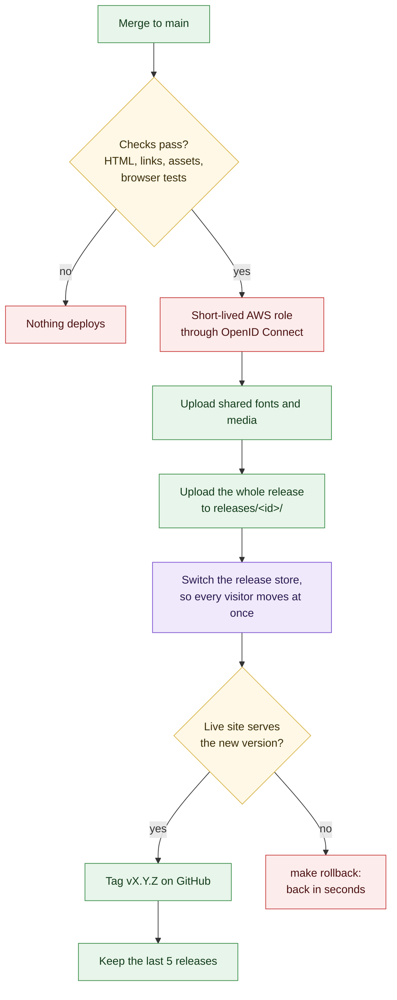

### How far a change has been proven

A version number says what changed. A release level says how far it has been proven: **Implemented** (merged with checks passing), **Verified** (named acceptance tests passed), **Released** (the right version is live and tagged), or **Qualified** (real use and recovery are established). A tag means Released, never Qualified on its own. The [versioning standard](../standards/versioning.md) has the rules.

## Trying a change on dev first

Pushing any branch puts it on dev.neon1.tech, a private copy of the site and 1NEON, in about 30 seconds, because dev runs only the quick checks.

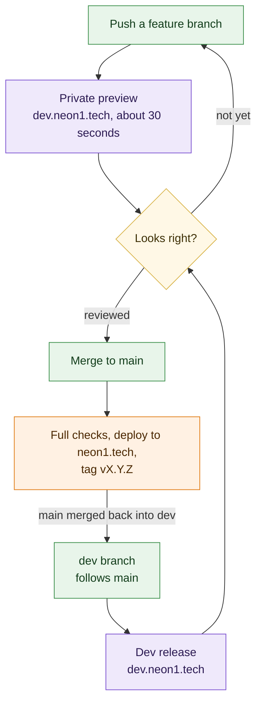

- **Branches and the dev release.** Each branch has its own preview at `dev.neon1.tech/__preview?b=<branch>`. The `dev` branch is the dev release. After every push to main, a workflow merges main into `dev`, and a conflict stops it rather than forcing anything.
- **Releases come only from main.** Main rebuilds with the full checks, including the browser tests and PDF printing dev skips.

### Who can open dev

Anyone not signed in gets the same bare "Not found" on every address. Signing in takes a secret link, which only starts a sign-in, and a passkey or email code for an account in dev's access group. A leaked link alone lets nobody in.

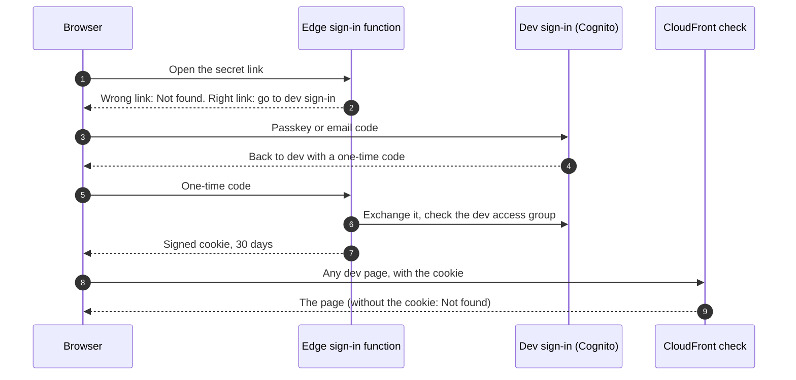

## One source for every word

The website, the Knowledge Center, 1NEON's guide, and Neo all read from neon1-corpus, a repository of Markdown documents. Each tagged release publishes a bundle for each reader, so one correction reaches all of them.

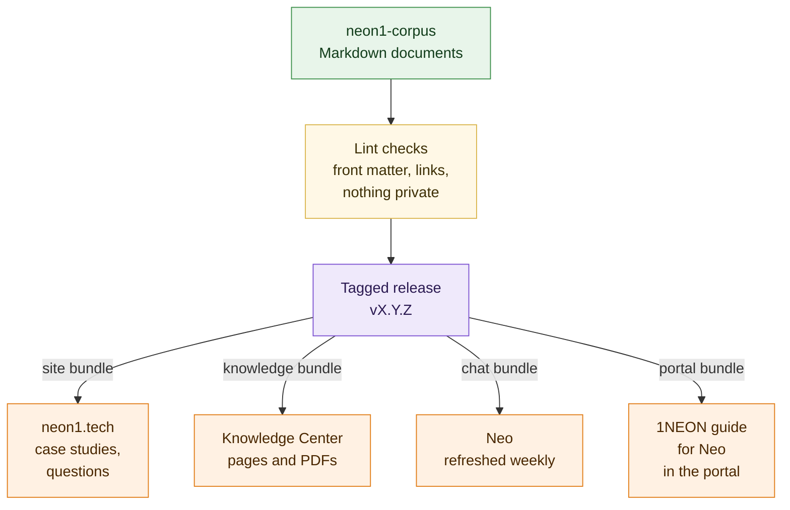

## A project in 1NEON

Every project moves through the same four layers.

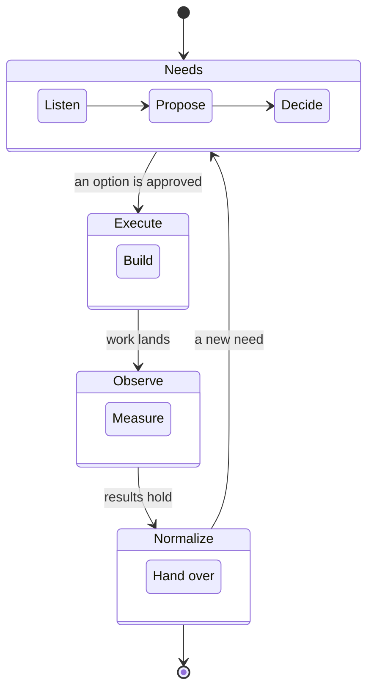

## Where to read more

- [neon1-aws-infrastructure](https://github.com/neon1llc/neon1-aws-infrastructure): the DNS, the CloudFront distribution, its routers and release store, the deploy permissions, and dev.neon1.tech (`site-dev/`).
- [neon1-site](https://github.com/neon1llc/neon1-site): the website and the Knowledge Center.
- [neon1-1NEON](https://github.com/neon1llc/neon1-1NEON): the portal, its API, and its infrastructure.
- [neon1-chat](https://github.com/neon1llc/neon1-chat): Neo.
- [neon1-corpus](https://github.com/neon1llc/neon1-corpus): every document, and these diagrams.
