# How neon1 is built

neon1 runs on a small set of AWS services, sized to cost a few dollars a month while it's quiet. Everything below is defined in code in public repositories on [GitHub](https://github.com/neon1llc), so each box here matches something you can read. The diagrams are drawn from Mermaid text, and each one has its source underneath it.

## The whole picture

One CloudFront distribution serves neon1.tech. It sends each address to the part of the system that owns it: the website, the 1NEON portal and its API, or Neo's API. Storage stays private, and only CloudFront can read the buckets. Every visit uses HTTPS, with strict security headers.

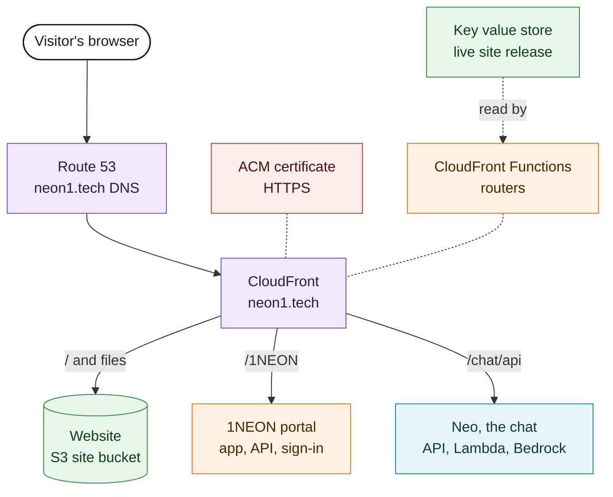

The colours follow AWS's own groups: purple for networking, orange for compute, green for storage, red for security, pink for messaging, and teal for machine learning.

- **Website.** Plain HTML, CSS, and JavaScript, with no framework and no tracking. The page loads only its own files, and its security policy blocks everything else.
- **1NEON.** A single-page app with its own API. Sign-in uses email codes, passkeys, authenticator apps, or Google, through Cognito. Data is kept per organization, and files go straight from the browser to a private documents bucket, where every upload is scanned for malware. Invoices are paid on Stripe's own checkout page, so card and bank details never reach neon1.
- **Neo.** A small function that answers questions from neon1's public documents, using a language model on Amazon Bedrock. Amazon doesn't keep the questions or answers, or train on them. Per-visitor limits keep it fair and cheap.
- **Watching it.** Alarms and monthly budgets email Pradeep when something fails or costs more than expected.

### Inside 1NEON

The portal's own pieces, from the browser's direct paths (sign-in, file uploads, and paying on Stripe) to the API's storage, records, and messages.

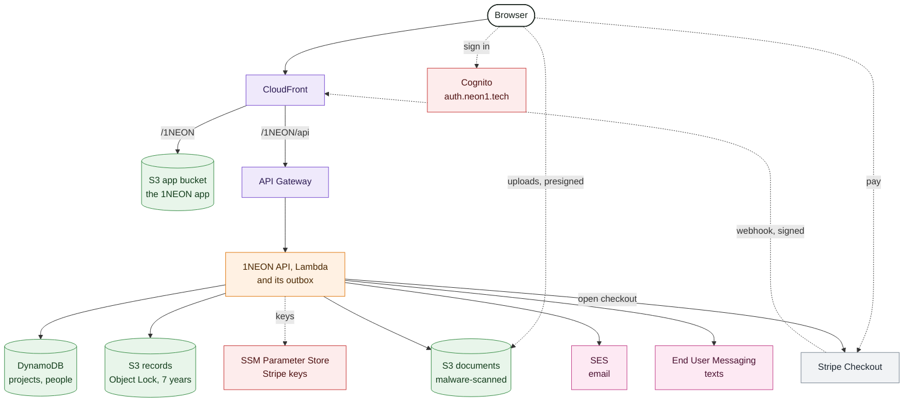

Signed approvals, handover acceptances, the service agreement's signatures, issued invoices, and payments live in DynamoDB like everything else, and a copy of each is also written to a records bucket under S3 Object Lock in governance mode, which keeps every copy unchanged for seven years. Nothing in that bucket expires on a schedule. Stripe's restricted key and its webhook signing secret are SecureString parameters under `/1neon/prod/stripe/`. Terraform creates them with placeholder values and never sees the real ones, and until they're set, online payment stays off.

## Paying an invoice

What happens between **Pay** in 1NEON and the invoice showing as paid. Card and bank details go only to Stripe. 1NEON learns about a payment only from Stripe's signed webhook, and it records each payment once, however many times Stripe sends the event.

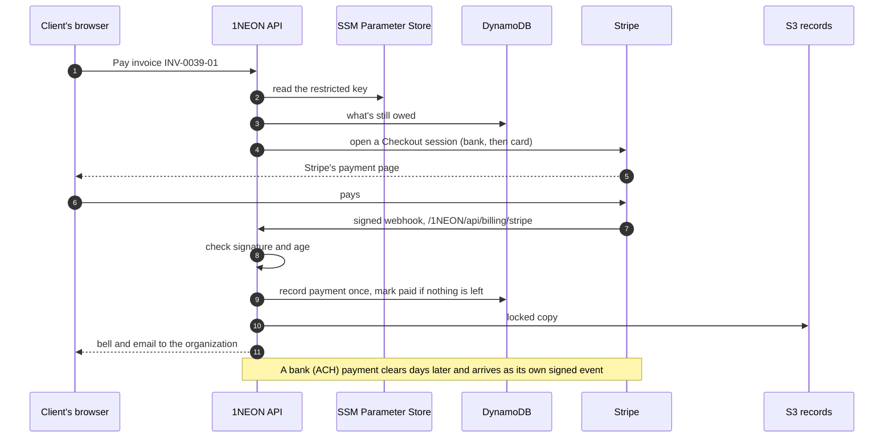

## Visiting neon1.tech

What happens between typing the address and seeing the page. Each deploy uploads the whole site into a new folder, and one small switch, the release store, tells CloudFront which folder is live. So every file in a visit comes from the same release, even while a deploy is running.

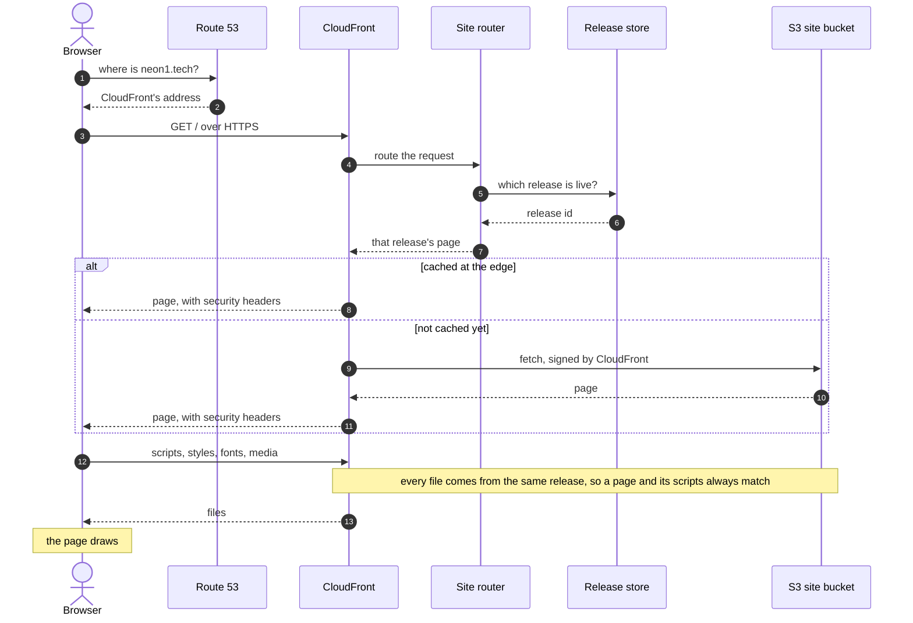

## Asking Neo

Neo only knows what's in neon1's public documents. Each question goes through CloudFront, which adds a secret header so the API answers only through neon1.tech, and through a check of the visitor's limits before the model sees it.

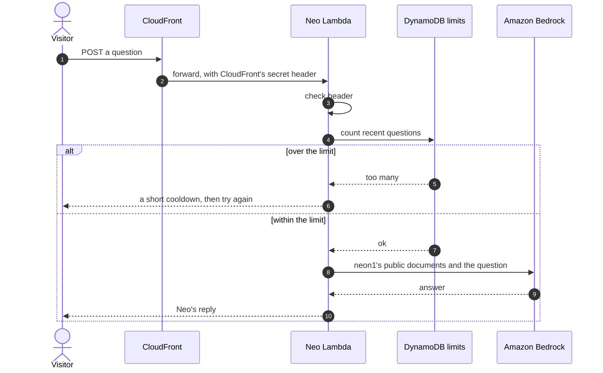

## Signing in to 1NEON

The portal has no passwords. Here is the email-code sign-in, the one the guided walkthrough shows. Passkeys and authenticator apps work the same way, with the code coming from the device.

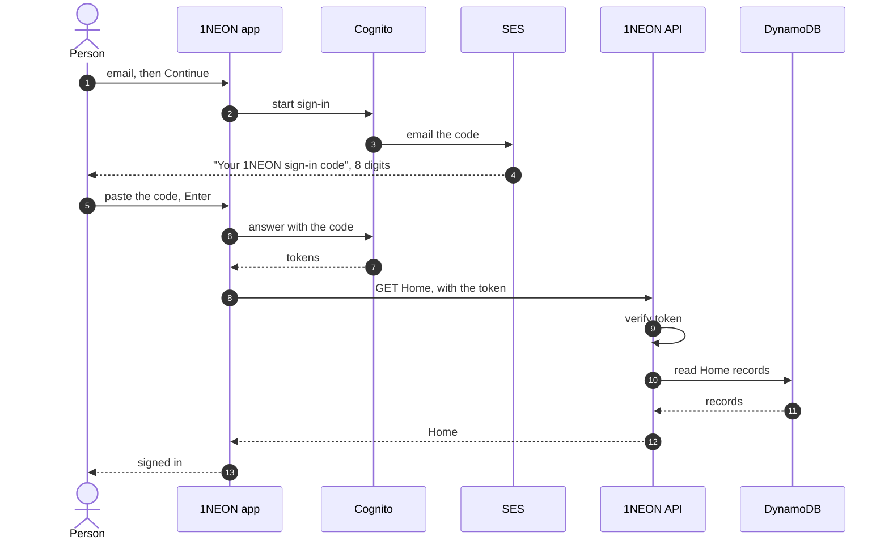

## How a change ships

Every repository deploys itself from its main branch. GitHub Actions signs in to AWS with short-lived credentials (OpenID Connect), so no repository holds AWS keys. Each deploy runs its checks first, confirms the live version afterwards, and tags the release. Work is usually seen on dev first, as the next section shows.

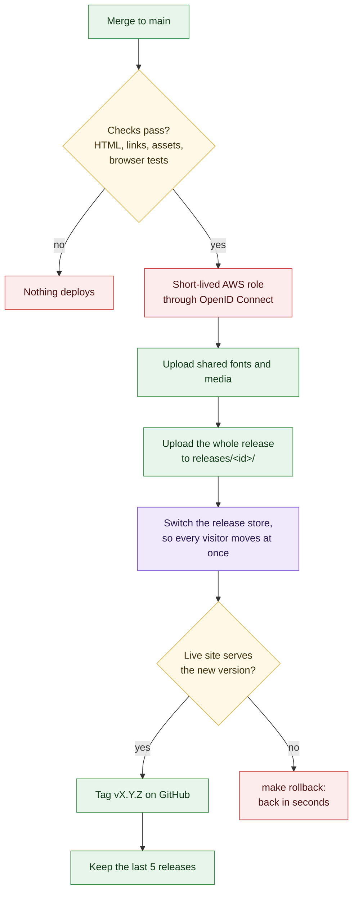

The other repositories follow the same pattern. 1NEON uploads its versioned files first and its page last. Infrastructure changes are planned and applied by Terraform, except permissions, which Pradeep applies by hand, so a deploy can never widen its own access.

## Trying a change on dev first

Before a change reaches neon1.tech, it can be seen on dev.neon1.tech, a private copy of the whole site and of 1NEON. Dev has its own bucket, CloudFront distribution, release store, 1NEON backend, sign-in pool, and permissions, so nothing done there can reach neon1.tech or production 1NEON. Pushing any branch puts it on dev in about 30 seconds, against about 6 minutes for a production deploy, because dev runs only the quick checks and is never tagged.

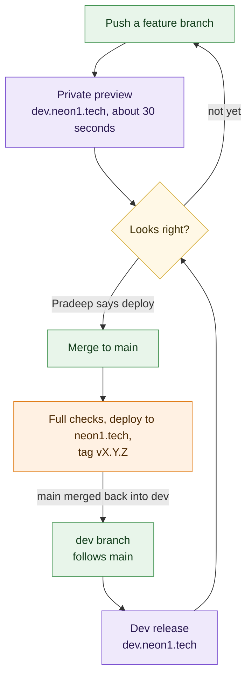

- **Branches and the dev release.** Each branch other than main gets its own preview, chosen with `dev.neon1.tech/__preview?b=<branch>`. The `dev` branch is the dev release. After every push to main, a workflow merges main into `dev` and rebuilds it.
- **Drafts in place.** A run of the dev workflow can build from a corpus branch, drafts included, so a post or a page can be read where it will appear before it's adopted.
- **Releases come only from main.** Dev builds are never tagged, announced, or counted as releases. Main rebuilds from the same commits and runs the full checks, including the browser tests and PDF printing that dev skips.
- **1NEON on dev.** The dev portal has its own API, table, documents bucket, and sign-in pool. Its data is a copy of production's, refreshed on request, with queued messages and sessions left out. Because that copy names real clients, dev admits only neon1's own accounts, sends mail only to neon1, and never creates an account for anyone else. Texts and the malware scan are off on dev, and its locked records are kept for a day instead of seven years.
- **What dev doesn't copy.** Dev uses the live Neo, since Neo only answers questions, and copies Knowledge Center PDFs from neon1.tech rather than printing them. Dev's infrastructure is applied by hand and never by a pipeline.
- **Cost.** Dev costs a few dollars a month, with a $5 budget alert on everything tagged as dev.

### Who can open dev

Nobody can see dev without signing in, and anyone who isn't signed in gets the same bare "Not found" on every address, so nothing shows that a site is there. Signing in takes two things: a secret link, which only starts a sign-in, and a passkey or email code for an account in dev's access group. A leaked link alone lets nobody in.

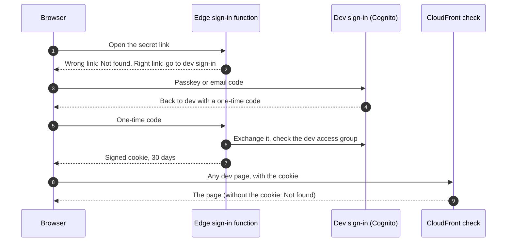

The link and the cookie use separate keys. A new link doesn't sign anyone out, and signing every device out doesn't change the link. Taking someone out of the access group stops their next sign-in.

## One source for every word

The website, the Knowledge Center, 1NEON's guide, and Neo all read from neon1-corpus, a repository of Markdown documents. Each tagged release of the corpus publishes a bundle for each reader, so a correction made once reaches all of them.

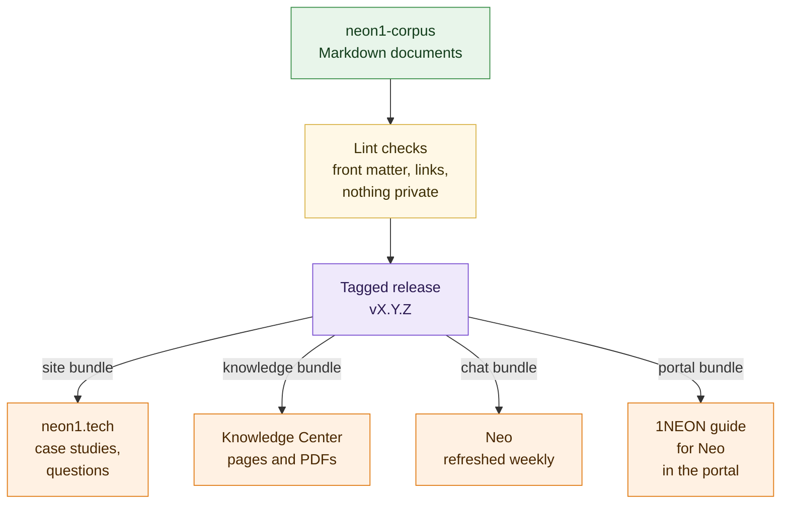

## A project in 1NEON

Every project moves through the same four layers, and the work in each one follows the way a project runs: listen, propose, decide, build, and hand over.

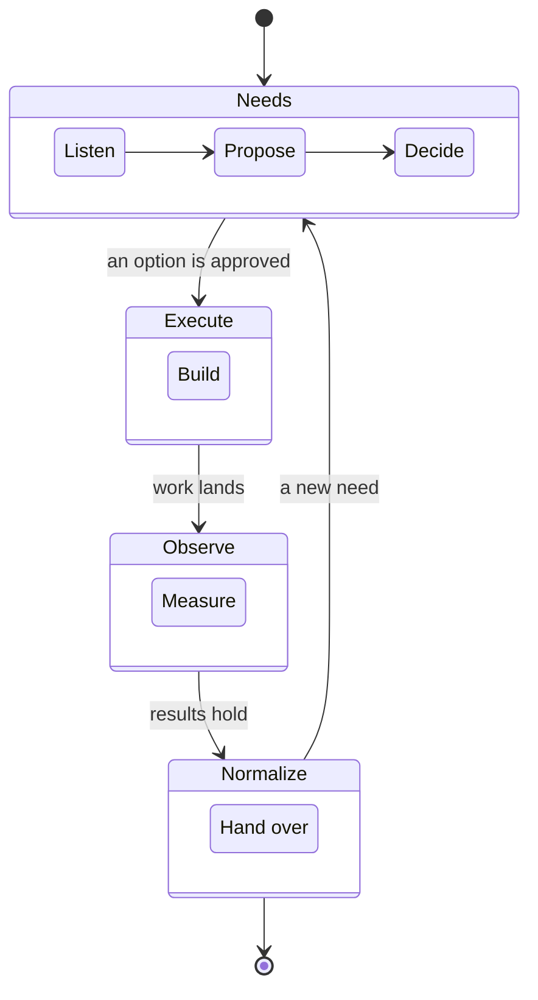

## Where to read more

- [neon1-aws-infrastructure](https://github.com/neon1llc/neon1-aws-infrastructure): the DNS, the CloudFront distribution, its routers and release store, the deploy permissions, and dev.neon1.tech (`site-dev/`).
- [neon1-site](https://github.com/neon1llc/neon1-site): the website and the Knowledge Center.
- [neon1-1NEON](https://github.com/neon1llc/neon1-1NEON): the portal, its API, and its infrastructure.
- [neon1-chat](https://github.com/neon1llc/neon1-chat): Neo.
- [neon1-corpus](https://github.com/neon1llc/neon1-corpus): every document, and these diagrams.
