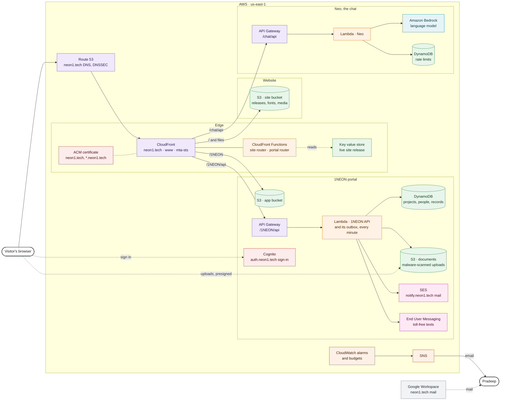
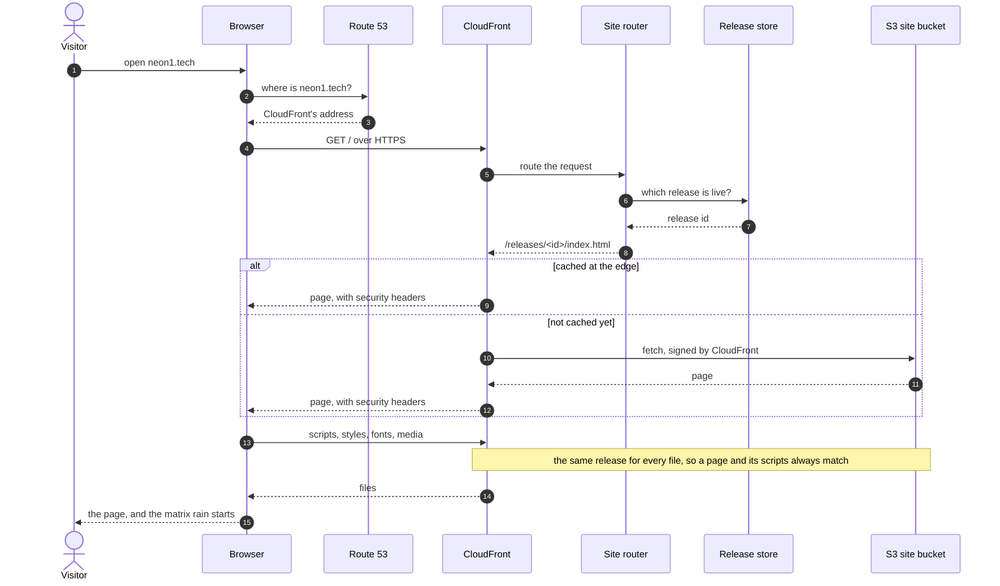
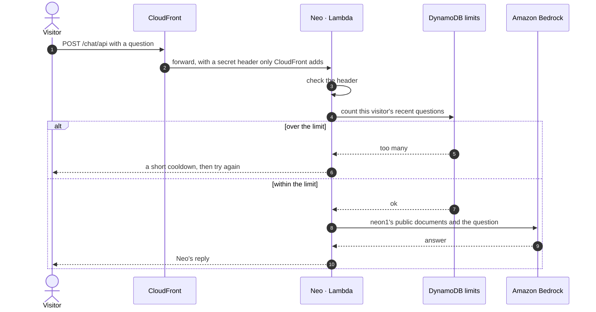
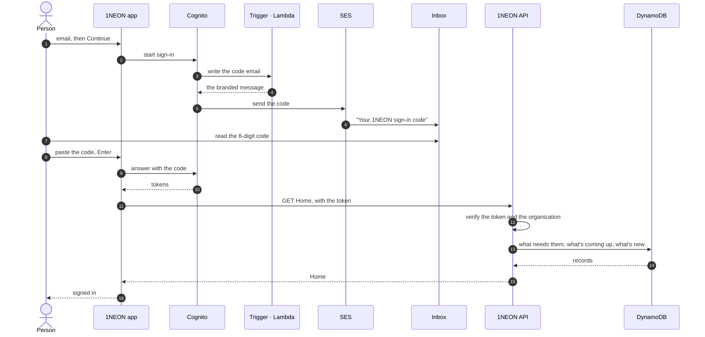
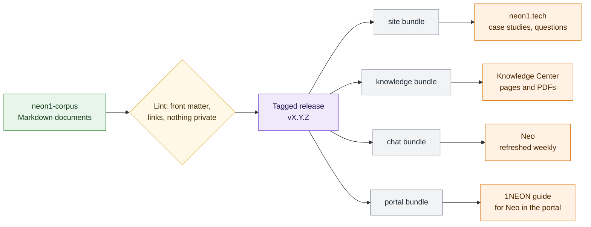
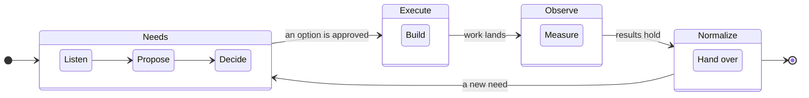

# How neon1 is built

neon1 runs on a small set of AWS services, sized to cost a few dollars a month while it's quiet. Everything below is defined in code in public repositories on [GitHub](https://github.com/neon1llc), so each box here matches something you can read. The diagrams are drawn from Mermaid text, and each one has its source underneath it.

## The whole picture

One CloudFront distribution serves neon1.tech. It sends each address to the part of the system that owns it: the website, the 1NEON portal and its API, or Neo's API. Storage stays private, and only CloudFront can read the buckets. Every visit uses HTTPS, with strict security headers.

The colours follow AWS's own groups: purple for networking, orange for compute, green for storage, red for security, pink for messaging, and teal for machine learning.

- **Website.** Plain HTML, CSS, and JavaScript, with no framework and no tracking. The page loads only its own files, and its security policy blocks everything else.
- **1NEON.** A single-page app with its own API. Sign-in uses email codes, passkeys, authenticator apps, or Google, through Cognito. Data is kept per organization, and files go straight from the browser to a private documents bucket, where every upload is scanned for malware.
- **Neo.** A small function that answers questions from neon1's public documents, using a language model on Amazon Bedrock. Amazon doesn't keep the questions or answers, or train on them. Per-visitor limits keep it fair and cheap.
- **Watching it.** Alarms and monthly budgets email Pradeep when something fails or costs more than expected.

## Visiting neon1.tech

What happens between typing the address and seeing the page. Each deploy uploads the whole site into a new folder, and one small switch, the release store, tells CloudFront which folder is live. So every file in a visit comes from the same release, even while a deploy is running.

## Asking Neo

Neo only knows what's in neon1's public documents. Each question goes through CloudFront, which adds a secret header so the API answers only through neon1.tech, and through a check of the visitor's limits before the model sees it.

## Signing in to 1NEON

The portal has no passwords. Here is the email-code sign-in, the one the guided walkthrough shows. Passkeys and authenticator apps work the same way, with the code coming from the device.

## How a change ships

Every repository deploys itself from its main branch. GitHub Actions signs in to AWS with short-lived credentials (OpenID Connect), so no repository holds AWS keys. Each deploy runs its checks first, confirms the live version afterwards, and tags the release.

The other repositories follow the same pattern. 1NEON uploads its versioned files first and its page last. Infrastructure changes are planned and applied by Terraform, except permissions, which Pradeep applies by hand, so a deploy can never widen its own access.

## One source for every word

The website, the Knowledge Center, 1NEON's guide, and Neo all read from neon1-corpus, a repository of Markdown documents. Each tagged release of the corpus publishes a bundle for each reader, so a correction made once reaches all of them.

## A project in 1NEON

Every project moves through the same four layers, and the work in each one follows the way a project runs: listen, propose, decide, build, and hand over.

## Where to read more

- [neon1-aws-infrastructure](https://github.com/neon1llc/neon1-aws-infrastructure): the DNS, the CloudFront distribution, its routers and release store, and the deploy permissions.
- [neon1-site](https://github.com/neon1llc/neon1-site): the website and the Knowledge Center.
- [neon1-1NEON](https://github.com/neon1llc/neon1-1NEON): the portal, its API, and its infrastructure.
- [neon1-chat](https://github.com/neon1llc/neon1-chat): Neo.
- [neon1-corpus](https://github.com/neon1llc/neon1-corpus): every document, and these diagrams.
