# How neon1 is built

neon1 runs on a small set of AWS services, sized to cost a few dollars a month while it's quiet. Everything below is defined in code in public repositories on [GitHub](https://github.com/neon1llc), so each box here matches something you can read. It covers how a visit, a question, a sign-in, and a payment flow through the system, how each part runs in production and on the private dev copy, what data each part keeps and for how long, and how a change gets from a branch to neon1.tech. The diagrams are drawn from Mermaid text, and each one has its source underneath it.

## The whole picture

One CloudFront distribution serves neon1.tech. It sends each address to the part of the system that owns it: the website, the 1NEON portal and its API, or Neo's API. Storage stays private, and only CloudFront can read the buckets. Every visit uses HTTPS, with strict security headers.

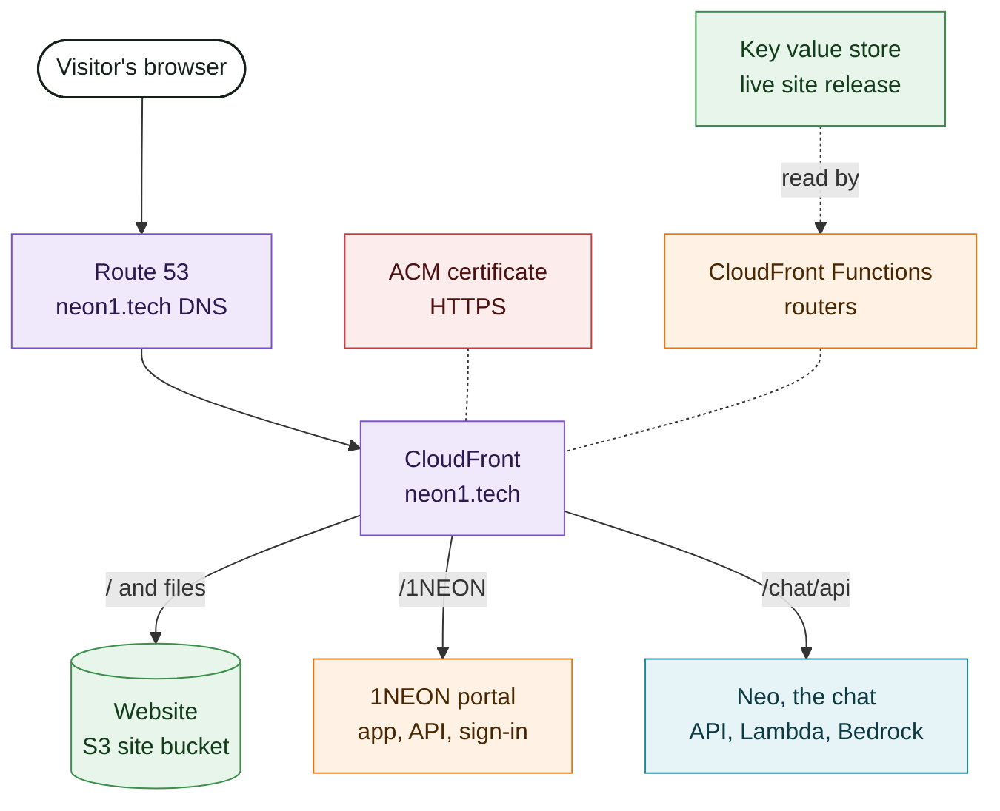

The colours follow AWS's own groups: purple for networking, orange for compute, green for storage, red for security, pink for messaging, and teal for machine learning.

- **Website.** Plain HTML, CSS, and JavaScript, with no framework and no tracking. The page loads only its own files, and its security policy blocks everything else.
- **1NEON.** A single-page app with its own API. Sign-in uses an emailed code or a passkey through Cognito, with an authenticator app as an optional second step, and there are no passwords. Data is kept per organization, and files go straight from the browser to a private documents bucket, where every upload is scanned for malware. Invoices are paid on Stripe's own checkout page, so card and bank details never reach neon1.
- **Neo.** A small function that answers questions from neon1's public documents, using a language model on Amazon Bedrock. Amazon says Bedrock doesn't train on them, and that some models may keep them for abuse detection. Per-visitor limits keep it fair and cheap.
- **Watching it.** Alarms and monthly budgets email Pradeep when something fails or costs more than expected.

### Inside 1NEON

The portal's own pieces, from the browser's direct paths (sign-in, file uploads, and paying on Stripe) to the API's storage, records, and messages.

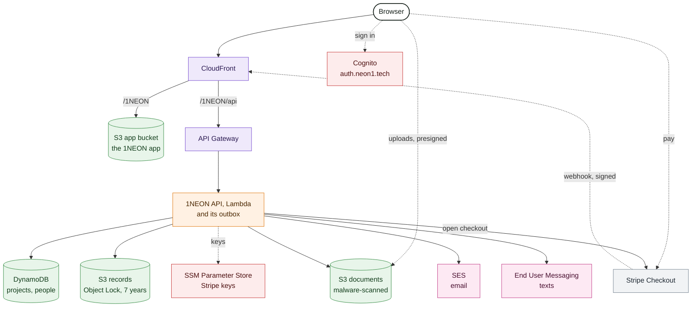

Signed approvals, handover acceptances, the service agreement's signatures, issued invoices, and payments live in DynamoDB like everything else, and a copy of each is also written to a records bucket under S3 Object Lock in governance mode, which write-protects every copy for seven years. Governance mode can be overridden by an administrator with a special permission. Stripe's restricted key and its webhook signing secret are SecureString parameters under `/1neon/prod/stripe/`. Terraform creates them with placeholder values and never sees the real ones, and until they're set, online payment stays off.

## Paying an invoice

What happens between **Pay** in 1NEON and the invoice showing as paid. Card and bank details go only to Stripe. 1NEON learns about a payment only from Stripe's signed webhook, and it records each payment once, however many times Stripe sends the event.

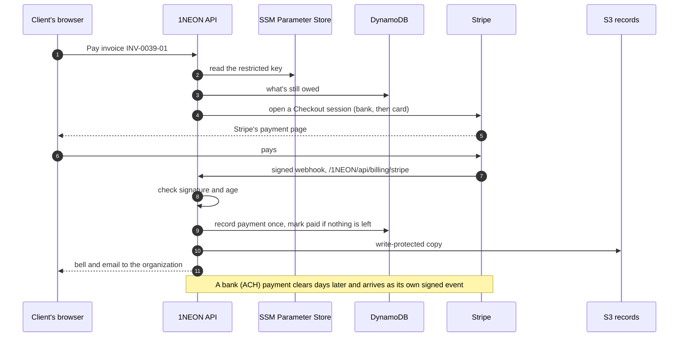

## Visiting neon1.tech

What happens between typing the address and seeing the page. Each deploy uploads the whole site into a new folder, and one small switch, the release store, tells CloudFront which folder is live. So every file in a visit comes from the same release, even while a deploy is running.

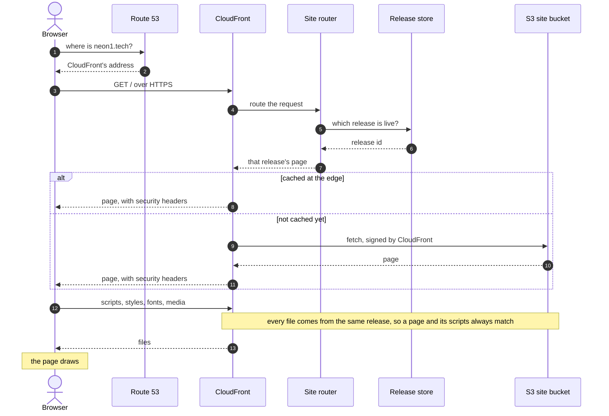

## Asking Neo

Neo takes every fact about neon1 from neon1's public documents, and answers general technology questions only as general information. Each question goes through CloudFront, which adds a secret header so the API answers only through neon1.tech, and through a check of the visitor's limits before the model sees it.

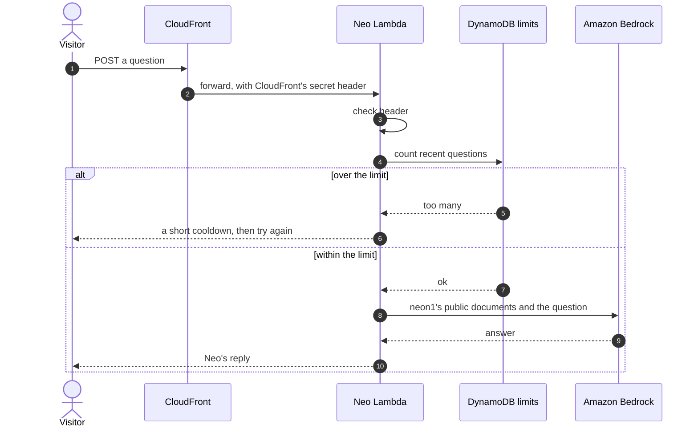

## Signing in to 1NEON

The portal has no passwords. Here is the email-code sign-in, the one the guided walkthrough shows. A passkey replaces the code with the device's own check, and an authenticator app, for anyone who sets one up, adds a 6-digit code as a second step.

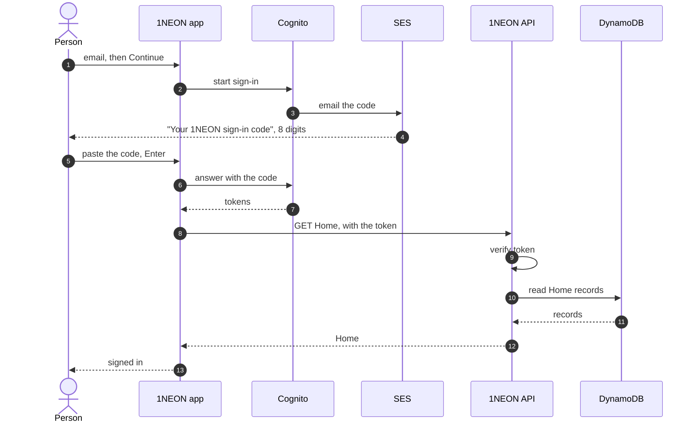

## Production and dev, part by part

Every part of neon1 has a production side, which is what clients and visitors use, and most have a private dev side for trying a change first. Nothing on dev can reach production or client data, because dev has its own buckets, CloudFront distribution, release store, 1NEON backend, sign-in pool, and permissions. Production changes only when Pradeep says deploy and the change merges to main. Dev changes whenever a branch is pushed, and it's never released.

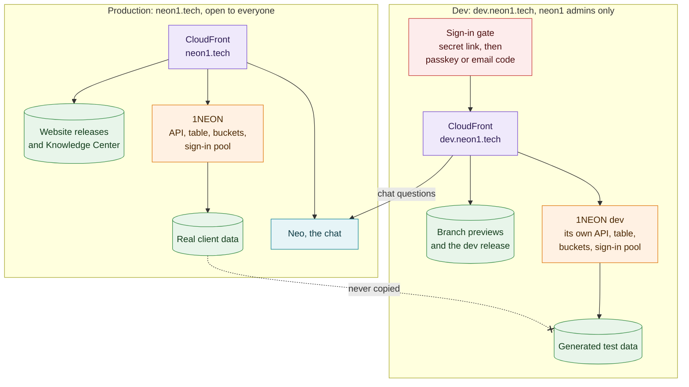

| Part | Production | Dev |
|---|---|---|
| **Website** | neon1.tech, served from whole releases in the site bucket. Changes only when main deploys. | dev.neon1.tech, with its own bucket, distribution, and release store. Every branch push builds a preview, and the `dev` branch is the dev release. |
| **Knowledge Center and blog** | Built from the newest corpus release with every site deploy, and republished on their own within about 15 minutes of a new corpus release. PDFs are printed during the deploy. | Built from the newest corpus release, or from a corpus branch so drafts can be read in place. PDFs are copied from neon1.tech rather than printed. |
| **1NEON** | neon1.tech/1NEON, with its own API, table, documents and records buckets, and sign-in pool. Malware scanning and seven-year record protection are on. | dev.neon1.tech/1NEON, a separate API, table, buckets, and sign-in pool holding generated test data only. Only neon1's own accounts can sign in, mail goes only to neon1, texts and the malware scan are off, and test records are write-protected for a day. |
| **Neo** | neon1.tech/chat/api, answering from the corpus copy it was last released with. | No dev copy. Dev sends questions to the live Neo, since Neo only answers from public pages and keeps no question text. |
| **Infrastructure** | The neon1.tech distribution and the shared DNS records are applied by the pipeline from main. Deploy permissions are applied by Pradeep by hand. | dev.neon1.tech's distribution, gate, and permissions are applied by hand only, never by a pipeline. |
| **Corpus** | A merge to main tags a release and publishes its bundles to every reader. | No environment of its own. A corpus branch is previewed through the website's dev build. |

## What data each part keeps

Everything runs in one AWS account in us-east-1 (US East, N. Virginia), encrypted in transit and at rest. Each part keeps only what it needs to do its job, and the public parts keep almost nothing. Production holds real client data. Dev holds generated test data only, made up for testing, and never a copy of production, so no real client's name, project, or file is ever on dev.

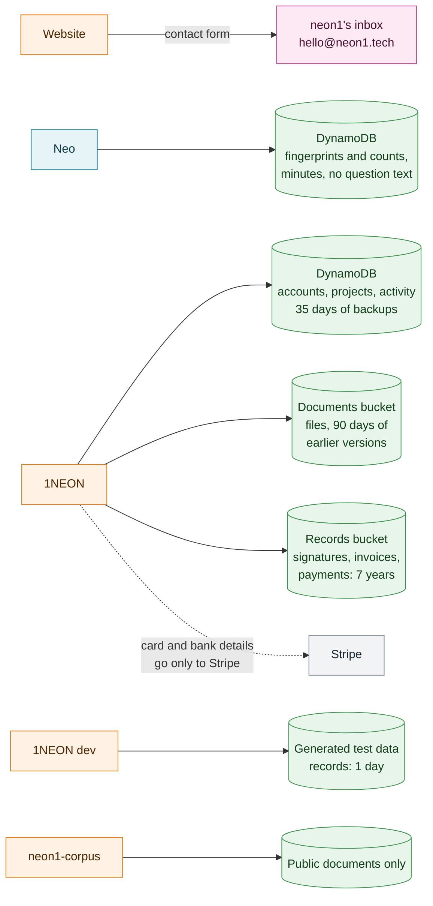

| Part | What it keeps | Why | How long |
|---|---|---|---|
| **Website** | No accounts, cookies, analytics, or trackers. Contact form messages are emailed to hello@neon1.tech and not stored by the site. The form's limits count each sender per hour by a one-way code of their address, in 1NEON's table, so no address is stored. | A visitor shouldn't be tracked to read a page. | CloudFront handles each request's IP address and browser details to deliver the page, and AWS may keep them briefly for security and operations. The contact form's counters expire a day after their first count. |
| **Neo** | No question or answer text. A one-way fingerprint of each question, to notice repeats, and visitor counts by a one-way code, for the question limits. Logs hold timing, length, and errors. Bedrock's own logging is off. | Enough to keep Neo fair and cheap, and to debug it, without keeping what people ask. | Fingerprints ten minutes. Logs two weeks. |
| **1NEON projects** | Accounts, projects, items, decisions, comments, and activity in DynamoDB, and uploaded files in the documents bucket, each organization's kept separate. | They're the record of the work, for both sides, during and after an engagement. | Never deleted on a schedule, and deleted when an organization asks. Database backups roll off after 35 days, and earlier copies of replaced or deleted files after 90. |
| **1NEON records** | A copy of every signature, issued invoice, and payment, under S3 Object Lock in governance mode. | Tax and contract law expect these kept. | Write-protected for seven years. |
| **1NEON system records** | The audit log of sign-ins and changes, and delivery records for emails and texts. | Security, and finding delivery problems. | Audit log up to three years, delivery records 30 days, API logs 90 days. |
| **Payments** | Stripe's restricted key and webhook secret, as encrypted parameters in SSM Parameter Store. | So 1NEON can open a checkout and trust Stripe's events. | Card and bank details go only to Stripe and never reach neon1. |
| **Dev** | Generated test data in dev's own table and buckets, and dev's sign-in pool, which holds only neon1's own accounts. | To try every screen and state without any client's data in reach. | Test records are write-protected for a day. |
| **Infrastructure** | Terraform state, in a versioned S3 bucket. No client data. | So each stack knows what it manages. | Earlier versions are kept for recovery. |
| **Corpus** | Public documents only. Its linter fails on anything that looks private. | Everything in it is published. | Kept in Git history. |

The [privacy and data policy](../policies/privacy.md) is the full statement of what's collected and how long it's kept, and it wins if anything here differs.

## How a change ships

neon1's public repositories fall into three groups: the ones that run neon1.tech, the documents, and the tools and guides. Every repository follows the same path, though only the first group deploys anything. A change starts on its own branch, where checks run on every push. Changes to the website and 1NEON can be seen on dev. A batch goes to production only when Pradeep says deploy: then it merges to main, the main pipeline runs every check again, deploys, confirms the live version, and tags the release from the changelog's top entry. GitHub Actions signs in to AWS with short-lived credentials through OpenID Connect, and each role trusts only its own repository, so no repository holds AWS keys.

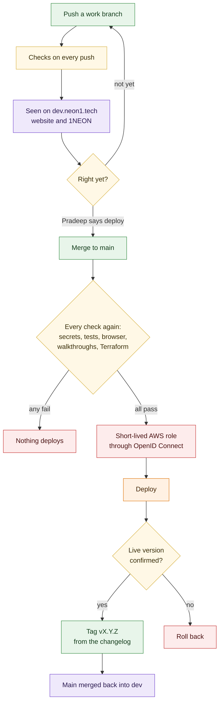

| Repository | Checks on every push | Where a branch can be seen | What main does | About how long |
|---|---|---|---|---|
| **neon1-site** | HTML, scripts, links, the asset manifest, sizes, secret scan, and the built corpus pages; browser checks of the contact form, case studies, white rabbit, and chat with every API faked | A private preview on dev.neon1.tech, in about 30 seconds | Prints the Knowledge Center PDFs, uploads a whole new release, switches the release store, confirms the live version, and tags | Together with the corpus and Neo, about 12 to 18 minutes |
| **neon1-1NEON** | Types, unit and contract tests, the production build, secret scan, Terraform checks, and every guided walkthrough played to its end card in a real browser, on a desktop and a phone screen | The `dev` branch ships to dev.neon1.tech/1NEON; any other branch on request | Applies its production Terraform first, ships the API, then the app with its page last, confirms the live version, and tags | About 26 minutes, most of it the walkthroughs |
| **neon1-chat** (Neo) | Tests with AWS faked, Terraform checks, and a secret scan | No dev copy | Applies its Terraform, which ships the function, checks the live endpoint through neon1.tech, and tags | Part of the 12 to 18 minutes above |
| **neon1-corpus** | Front matter, links, anything that looks private, the Markdown renderer, and every diagram drawn with alt text | A branch can be built into a dev preview of the website | Tags the release, publishes a bundle for each reader, and asks neon1.tech to publish it | Part of the 12 to 18 minutes above |
| **neon1-aws-infrastructure** | Formatting, validation, lint, misconfiguration scan, and secret scan | Dev's stack is applied by hand | Plans every stack and applies the neon1.tech distribution and the shared DNS records; deploy permissions only plan, and Pradeep applies them by hand | A few minutes |
| **Tools**: [DeployOps](https://github.com/neon1llc/deploy-ops), [AWS CLIP](https://github.com/neon1llc/aws-clip), and [refmark](https://github.com/neon1llc/refmark) | Their own checks and tests | No dev copy | Nothing deploys; each changelog version is tagged only if the checks pass, and refmark also checks the sources neon1 cites every Monday | A few minutes |
| **Education**: Ready, Secure, Go and its five companion guides | Front matter, links, and each guide's own rules | No dev copy | Nothing deploys; each changelog version is tagged | A few minutes |

A few details hold across all of them:

- **One release at a time.** Each pipeline runs in a lock and never cancels a release halfway. 1NEON and Neo also stop a queued release if main has already moved on, so an older commit can't overwrite a newer one.
- **Tags follow the changelog.** Each change adds an entry under `## Unreleased`. On deploy, that entry becomes the new version, and the tag is made by the pipeline once the live version is confirmed, never by hand. Dev builds are never tagged.
- **Permissions stay outside the pipeline.** Each pipeline's role can't change its own access, so a deploy can never widen it.
- **Corpus words reach readers on their own.** A corpus release asks the website to rebuild, and the website also checks every 15 minutes whether it shows the newest release. Every Monday, Neo's refresh job opens a pull request with any change from the newest release, which ships like any other change.

### Deploying the website

The website's deploy, step by step. The release switch means every visitor moves from one complete release to the next at once.

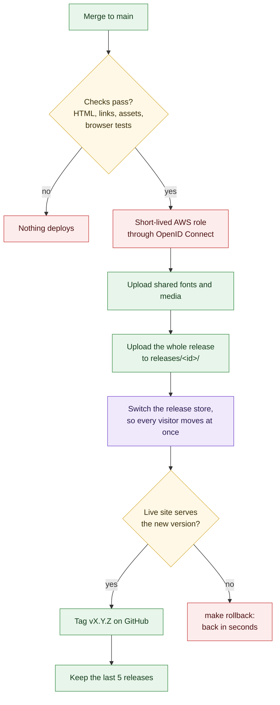

### How far a change has been proven

A version number says what changed. A release level says how far it has been proven, and descriptions of the work never get ahead of its level.

| Level | Means | Evidence |
|---|---|---|
| **Implemented** | The code exists | Merged with its checks passing, and a changelog entry |
| **Verified** | Named acceptance tests passed | The scenarios it affects pass in CI, plus a check on dev or in the demo for anything people see |
| **Released** | The right version is live | Pradeep said deploy, the pipeline deployed it, the live version matches, and the tag exists |
| **Qualified** | Real use and recovery are established | Representative real use, a safe check in production, and its recovery path, such as a rollback or a restore, tested at least once |

A tag means Released, never Qualified on its own. The [versioning standard](../standards/versioning.md) has the full rules.

## Trying a change on dev first

Before a change reaches neon1.tech, it can be seen on dev.neon1.tech, a private copy of the whole site and of 1NEON. Pushing any branch puts it on dev in about 30 seconds, because dev runs only the quick checks and is never tagged. A production release takes longer because it runs every check.

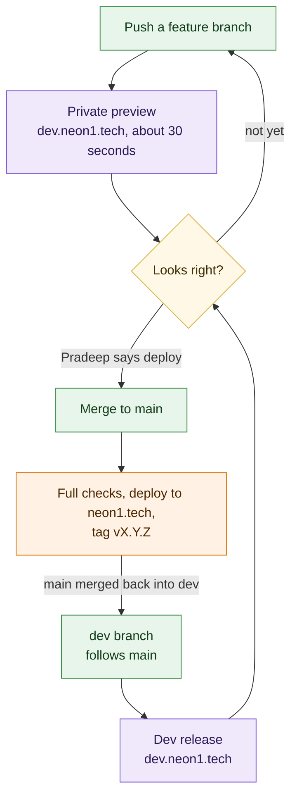

- **Branches and the dev release.** Each branch other than main gets its own preview, chosen with `dev.neon1.tech/__preview?b=<branch>`. The `dev` branch is the dev release. After every push to main, a workflow merges main into `dev` and rebuilds it, and a merge that conflicts stops and says so rather than forcing anything.
- **Drafts in place.** A run of the dev workflow can build from a corpus branch, drafts included, so a post or a page can be read where it will appear before it's adopted.
- **Releases come only from main.** Dev builds are never tagged, announced, or counted as releases. Each work branch goes to main on its own, never the `dev` branch as a whole, and main rebuilds from the same commits and runs the full checks, including the browser tests and PDF printing that dev skips.
- **1NEON on dev.** The dev portal runs on generated test data, never a copy of production, so every screen and state can be tried without a real client's data in reach. Even so, dev admits only neon1's own accounts, sends mail only to neon1, and never creates an account for anyone else.
- **Cost.** Dev costs a few dollars a month, with a $5 budget alert on everything tagged as dev.

### Who can open dev

Nobody can see dev without signing in, and anyone who isn't signed in gets the same bare "Not found" on every address, so nothing shows that a site is there. Signing in takes two things: a secret link, which only starts a sign-in, and a passkey or email code for an account in dev's access group. A leaked link alone lets nobody in.

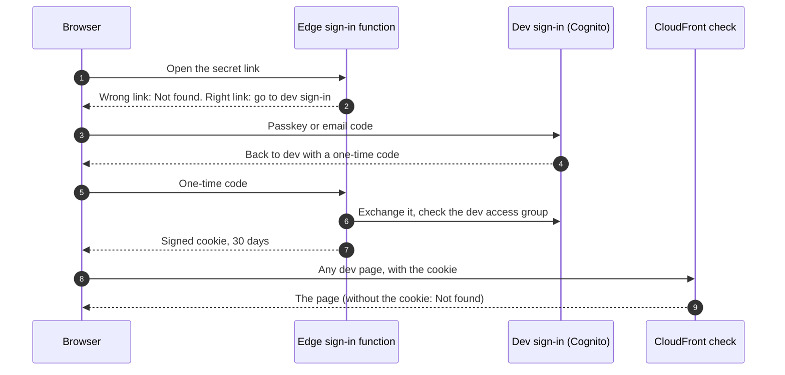

The link and the cookie use separate keys. A new link doesn't sign anyone out, and signing every device out doesn't change the link. Taking someone out of the access group stops their next sign-in.

## One source for every word

The website, the Knowledge Center, 1NEON's guide, and Neo all read from neon1-corpus, a repository of Markdown documents. Each tagged release of the corpus publishes a bundle for each reader, so a correction made once reaches all of them.

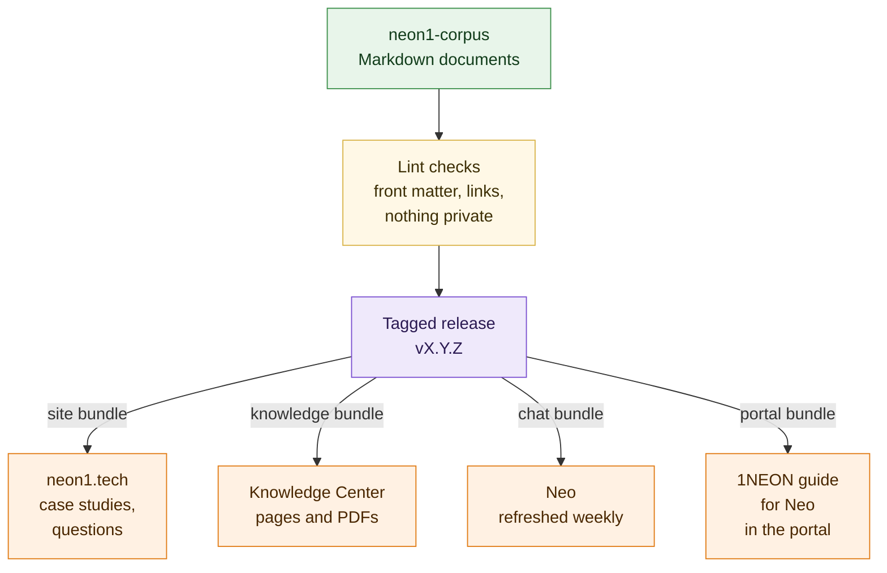

## A project in 1NEON

Every project moves through the same four layers, and the work in each one follows the way a project runs: listen, propose, decide, build, and hand over.

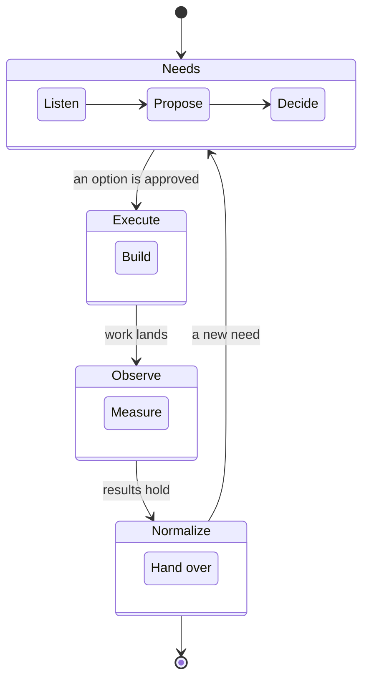

## Where to read more

- [neon1-aws-infrastructure](https://github.com/neon1llc/neon1-aws-infrastructure): the DNS, the CloudFront distribution, its routers and release store, the deploy permissions, and dev.neon1.tech (`site-dev/`).
- [neon1-site](https://github.com/neon1llc/neon1-site): the website and the Knowledge Center.
- [neon1-1NEON](https://github.com/neon1llc/neon1-1NEON): the portal, its API, and its infrastructure.
- [neon1-chat](https://github.com/neon1llc/neon1-chat): Neo.
- [neon1-corpus](https://github.com/neon1llc/neon1-corpus): every document, and these diagrams.
